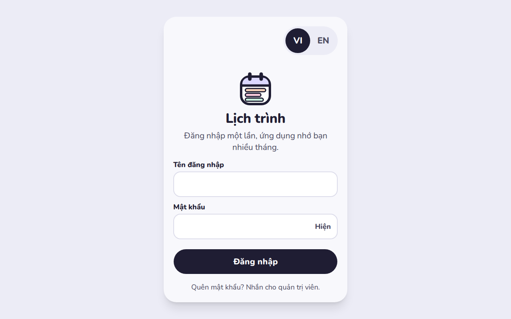

# Lichtrinh

A shared trip calendar for a parent who plans by talking. She speaks or types to Claude in Vietnamese, and Claude fills in the calendar while the rest of the family signs in to see the same plan and edit it. Lịch trình is Vietnamese for itinerary.

<picture>
  <source media="(prefers-color-scheme: dark)" srcset="assets/evidence/readme/dark.png" />
  
</picture>

## Why

My mom is traveling to Vietnam. Calendar apps ask her to learn them first. This one asks her to say what she wants to do and when, in her own language, with or without diacritics.

## How it fits together

- A web app installed to the iPhone home screen, in Vietnamese and English
- A shared calendar with trips, entries, estimated costs, and a budget, editable by hand
- A chat with Claude that changes the calendar through a narrow set of tools, with Undo on every change
- Claude and Vietnamese speech recognition run on my own computer, so the app costs nothing to run beyond the subscription I already pay for

## Status

Early development. See `canon/REQUIREMENTS.md` for what the app sets out to do.

## Development

Install [Bun](https://bun.sh), then run:

```bash
bun install
bun scripts/seed.ts
bun run dev
```

The seed migrates the local database and adds two invented accounts to sign in with, whose passwords sit in `scripts/seed.ts`. `bun run check` runs the same checks as the pre-push hook. `CONTRIBUTING.md` covers the rest.

## Usage

Run `bun link` once in the checkout, then `lichtrinh --help` from any folder for the product's own services, such as `lichtrinh db migrate` for the local database.

## License

MIT, in `LICENSE`.
