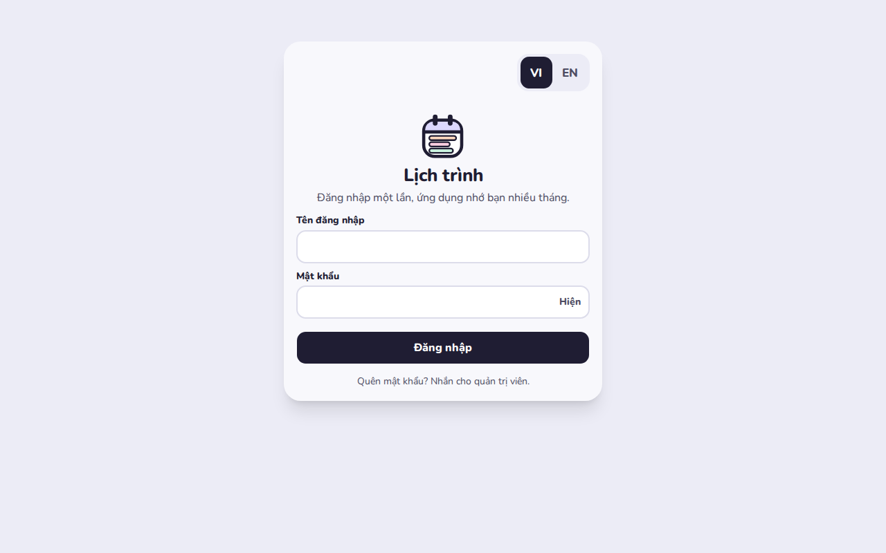

# Lichtrinh

A shared trip calendar for a parent who plans by talking. She speaks or types to Claude in Vietnamese, and Claude fills in the calendar while the rest of the family signs in to see the same plan and edit it. Lịch trình is Vietnamese for itinerary.

<picture>
  <source media="(prefers-color-scheme: dark)" srcset="e2e/evidence/readme/dark.png" />
  
</picture>

## Why

My mom is traveling to Vietnam. Calendar apps ask her to learn them first. This one asks her to say what she wants to do and when, in her own language, with or without diacritics.

## How it fits together

- A web app that opens in the browser, in Vietnamese and English
- A shared calendar with trips, entries, estimated costs, and a budget, editable by hand
- A chat with an assistant that changes the calendar through four calendar tools alone, with Undo on every change
- The assistant's local model and its Vietnamese and English speech recognition run on my own computer, so the app costs nothing to run
- The assistant defaults to `lichtrinh-assistant` on `qwen3.8:27b` and speech to `qwen3-asr-1.7b`, picked on the scores in `docs/benchmarks.md`

## Status

Early development. Every merge updates a staging copy on Cloudflare, and every release updates the family's. You can sign in, plan trips by hand or by chat, talk to the assistant through the mic, see every trip by month, week, and day, check a trip's budget, read its change history, undo any change, and read the last loaded plan offline.

Still to come are the guided tutorial and the practice trip. `canon/REQUIREMENTS.md` holds the full scope.

## Development

Install [Bun](https://bun.sh), then run:

```bash
bun install
bun scripts/seed.ts
bun run dev
```

The seed migrates the local database and adds two invented accounts to sign in with, whose passwords sit in `scripts/seed.ts`, plus two invented trips in 2031 with their entries, costs, and chats, and an exchange rate for the home-currency estimate. `bun run check` runs the same checks as the pre-push hook. `CONTRIBUTING.md` covers the rest.

On the workspace PC, `bun run dev:full` runs the whole app at once. It seeds a database of its own with a trip around today, starts the app, voice, and the assistant bridge, prints the link and the sign-ins, and stops all three on Ctrl-C. Pass `--reset` for fresh data.

## Usage

Run `bun link` once in the checkout, then `lichtrinh --help` from any folder for the product's own services.

- `lichtrinh db migrate` applies the migrations to the local database
- `lichtrinh admin create <username>` makes an admin account and prints its password once
- `lichtrinh bridge run` connects the assistant on the workspace PC, and `lichtrinh bridge eval` scores a model alias
- `lichtrinh voice serve` runs the speech recognition server the talk button sends clips to
- `lichtrinh panel install` puts a shortcut on the Windows desktop that starts voice and the bridge and opens a panel over them

## License

MIT, in `LICENSE`.
